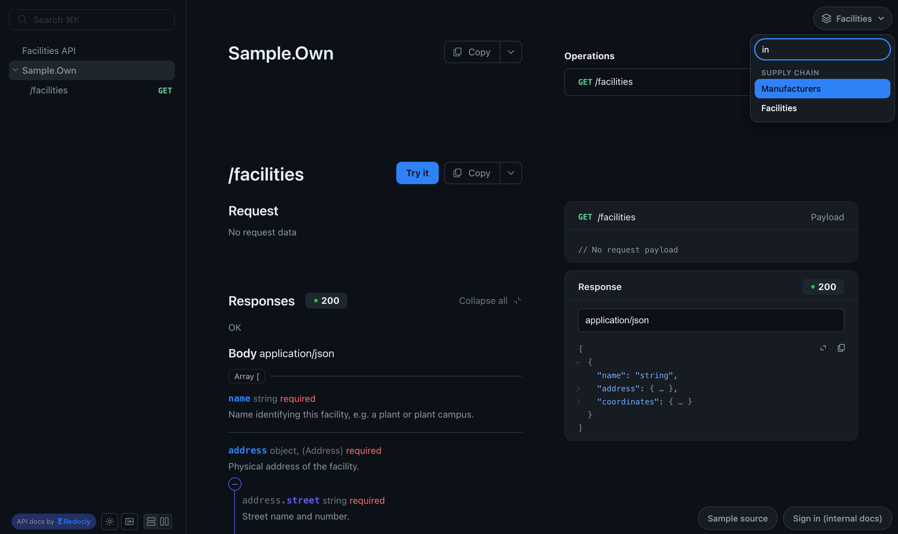

# ReDoc for ASP.NET Core

**ReDoc 3, served by your own app: a "Try it" console, authorization per document, several OpenAPI
documents with a picker, and a page with nothing inline and no third-party requests.** Still on a
ReDoc 2 page from Swashbuckle 10.x or Redoc.AspNetCore? Adapters give it a dark theme and the same
picker.

[](https://github.com/hlib-zinchenko/Hlibz.Redoc/actions/workflows/ci.yml)
[](https://github.com/hlib-zinchenko/Hlibz.Redoc/blob/main/LICENSE)



<sub>ReDoc 3 on Hlibz.Redoc.AspNetCore, with the searchable, grouped document picker top-right.</sub>

## Hlibz.Redoc.AspNetCore: ReDoc 3 in your app

```bash
dotnet add package Hlibz.Redoc.AspNetCore
```

```csharp
builder.Services.AddOpenApi("public");
builder.Services.AddOpenApi("internal");

// ...

app.MapReDocDocuments(
    [
        new ReDocDocument("public", "Public API"),
        new ReDocDocument("internal", "Internal API").RequireAuthorization("Employees"),
    ],
    docs => docs.EnableTryIt());
```

That serves a ReDoc 3 page per document under `/api-docs`, with a picker between them:

- **"Try it" console.** A **Try it** button on every operation: set parameters, credentials and a
  JSON body pre-filled from the schema, send the request, read the response. ReDoc's own console
  is a Redocly commercial feature; this one is off until you call `EnableTryIt()`.
- **Authorization per document.** `.RequireAuthorization()` on a document covers its page, its
  OpenAPI document *and* its link in the other pages' pickers. Anonymous visitors above see the
  public API and nothing that names the internal one.
- **Several documents, one picker**, with groups, search and placement in a corner or in ReDoc's
  sidebar. Swagger UI has a definition selector; ReDoc has none on any version.
- **A bundle that caches**: 527 KB brotli, pre-compressed, `immutable` with a strong ETag.
- **A strict CSP with no nonce.** Nothing on the page is inline, so `script-src 'self'` holds.
- **No third-party requests**, ReDoc's telemetry off, AOT-compatible, and no dependency beyond
  ASP.NET Core. Any generator that registers an `IDocumentProvider` works: `AddOpenApi()`,
  Swashbuckle or NSwag.

Full docs: [Hlibz.Redoc.AspNetCore README](https://github.com/hlib-zinchenko/Hlibz.Redoc/blob/main/src/Hlibz.Redoc.AspNetCore/README.md).

[](https://www.nuget.org/packages/Hlibz.Redoc.AspNetCore)
[](https://www.nuget.org/packages/Hlibz.Redoc.AspNetCore)

## Adapters: a dark theme for ReDoc 2

Keeping the `UseReDoc` page that Swashbuckle 10.x or Redoc.AspNetCore serves? Both embed ReDoc 2,
which has no dark mode. Add two lines and you get a proper dark ReDoc, an optional Light/System/Dark
switcher, and several OpenAPI documents with a dropdown between them:

```csharp
app.UseReDoc(options =>
{
    options.SpecUrl = "/openapi/v1.json";
    options.UseDarkTheme();                 // that's the whole zero-config path
});
```

```bash
dotnet add package Hlibz.Redoc.Extensions.Swashbuckle      # for Swashbuckle.AspNetCore.ReDoc 10.x
dotnet add package Hlibz.Redoc.Extensions.RedocAspNetCore  # for Redoc.AspNetCore
```

> **The adapters are in maintenance mode.** `Swashbuckle.AspNetCore.ReDoc` 11.x embeds ReDoc 3.1.0,
> which has dark mode built in, so the dark theme, their main feature, isn't needed there, and the
> Swashbuckle adapter stops below 11. They stay on NuGet and keep working on ReDoc 2 hosts, but no
> new features are planned: new work goes into `Hlibz.Redoc.AspNetCore`. On Swashbuckle 11 and
> want a picker, a "Try it" console or per-document authorization? Use the host instead.

[](https://www.nuget.org/packages/Hlibz.Redoc.Extensions.Swashbuckle)
[](https://www.nuget.org/packages/Hlibz.Redoc.Extensions.Swashbuckle)<br>
[](https://www.nuget.org/packages/Hlibz.Redoc.Extensions.RedocAspNetCore)
[](https://www.nuget.org/packages/Hlibz.Redoc.Extensions.RedocAspNetCore)

## Pick a package

Install **one**. Each one brings in `Hlibz.Redoc.Extensions.Core`, the shared engine, by itself — you
never reference that directly.

| Your situation | Install | Docs |
|---|---|---|
| Starting fresh, no ReDoc middleware yet | **`Hlibz.Redoc.AspNetCore`** | [README](https://github.com/hlib-zinchenko/Hlibz.Redoc/blob/main/src/Hlibz.Redoc.AspNetCore/README.md) |
| Want ReDoc 3, a "Try it" console, per-document authorization, real cache headers, or a page with nothing inline | **`Hlibz.Redoc.AspNetCore`** | as above |
| On `Swashbuckle.AspNetCore.ReDoc` 10.x, want dark docs and/or a document picker | **`Hlibz.Redoc.Extensions.Swashbuckle`** | [README](https://github.com/hlib-zinchenko/Hlibz.Redoc/blob/main/src/Hlibz.Redoc.Extensions.Swashbuckle/README.md) |
| On `Swashbuckle.AspNetCore.ReDoc` 11.x | nothing for the dark theme: ReDoc 3 has its own. For a picker, a console or per-document authorization, **`Hlibz.Redoc.AspNetCore`** | [README](https://github.com/hlib-zinchenko/Hlibz.Redoc/blob/main/src/Hlibz.Redoc.AspNetCore/README.md) |
| On `Redoc.AspNetCore`, same as 10.x | **`Hlibz.Redoc.Extensions.RedocAspNetCore`** | [README](https://github.com/hlib-zinchenko/Hlibz.Redoc/blob/main/src/Hlibz.Redoc.Extensions.RedocAspNetCore/README.md) |
| On `Hlibz.Redoc.AspNetCore.Extensions` 1.x | **`Hlibz.Redoc.Extensions.RedocAspNetCore`** | renamed, same code: a package swap, no API change |

All four ship in lockstep — one version from the release tag drives every package — so those three
versions always match.

Whichever you install, the namespace is `Hlibz.Redoc.Extensions;` — one `using`, and the code you
write doesn't change if you switch hosts later.

## What each one gives you

Both adapters behave identically; the package reference differs, the code doesn't.

| | `Hlibz.Redoc.AspNetCore` | The two adapters |
|---|---|---|
| How the page is served | this package serves it | the host serves it; this package adds to it |
| ReDoc version | 3.2.0, embedded here | whatever the host embeds: 2.5.4 (Swashbuckle 10.x) or 2.0.0 (Redoc.AspNetCore) |
| Dark mode | ReDoc 3's own, plus three named dark palettes and two light ones | this package's dark theme, with a Light/System/Dark switcher |
| Multiple documents + picker | yes, with groups, search and placement | yes, with groups |
| Authorization per document | `.RequireAuthorization()` on a document covers its page, its spec and its link | not possible: the host's page is middleware, which carries no metadata |
| Bundle on the wire | 527 KB brotli / 660 KB gzip, pre-compressed | 1 MB uncompressed (Redoc.AspNetCore) |
| `Cache-Control` on the bundle | `public, max-age=31536000, immutable` + strong ETag | `max-age=0` (Swashbuckle); none sent at all (Redoc.AspNetCore) |
| Strict CSP | `script-src 'self'`, no nonce — nothing is inline | needs a nonce; the host's own `Redoc.init` is inline |
| Third-party requests | none; ReDoc telemetry off by default | Google Fonts, unless you call `UseSystemFonts()` |
| Print stylesheet | yes | yes |
| "Try it" console | yes, opt-in: JSON, form and file bodies; bearer, Basic, API-key and pasted OAuth tokens | no |
| Dependencies | ASP.NET Core only | the host package |

## What this doesn't do

- **It doesn't generate OpenAPI documents.** `AddOpenApi()`, `AddSwaggerGen()` or NSwag still do
  that; these packages render what they produce.
- **No "Try it" console on the adapters.** ReDoc's own is a Redocly commercial feature. Only
  `Hlibz.Redoc.AspNetCore` ships one of its own, and it is deliberately small so far: JSON and
  form-encoded bodies; bearer, Basic and API-key auth; and a pasted token for OAuth 2.0 and OpenID
  Connect, with no login flow.
- **Hiding a document is not access control.** `Unlisted` hides a link, and gating a documentation
  page keeps your internal surface off the open web. Neither protects the API endpoints the
  document describes — those need their own authorization.
- **ReDoc 3 is not a drop-in for ReDoc 2 for deep links.** ReDoc 2's
  `#tag/widgets/operation/GetWidget` anchors don't resolve in ReDoc 3's page-per-operation router,
  so bookmarks break if you move to `Hlibz.Redoc.AspNetCore`.

## Compatibility

| | `Hlibz.Redoc.AspNetCore` | The two adapters |
|---|---|---|
| Library target | `net8.0`, `net11.0` | `net8.0`, `net11.0` |
| Works in apps targeting | net8.0 through net11.0 | net8.0 through net11.0 |
| Requires | nothing but ASP.NET Core | `Redoc.AspNetCore` ≥ 1.0.0, or `Swashbuckle.AspNetCore.ReDoc` 10.x (≥ 10.3.1) |
| OpenAPI generator | any that registers an `IDocumentProvider`: `AddOpenApi`, Swashbuckle, NSwag | the host's own |
| Trimming / AOT | `IsAotCompatible`, end to end: nothing here serializes reflectively | `IsAotCompatible` for this assembly only — the host serializes ReDoc's config reflectively |

Referencing both adapters from one project is a `CS0433` ambiguity: they declare the same public
type names in the same namespace on purpose, so the code you write doesn't change when you switch
hosts. Installing one is the supported case.

## Why trust it

Four test suites, run on every push: the host-free engine, one shared conformance suite compiled
once per adapter (so both hosts are held to the same assertions), and the ReDoc 3 host's own —
including the three authorization setups as the status codes an anonymous caller gets. The rendered
page is checked by hand in a browser on all three hosts; anything in these docs stated as measured
was measured there, not inferred.

Three runnable samples serve the same four OpenAPI documents, one per package, so you can compare
the hosts side by side. See
[CONTRIBUTING.md](https://github.com/hlib-zinchenko/Hlibz.Redoc/blob/main/CONTRIBUTING.md).

## Why this exists

When I started using ReDoc, the first thing I wanted was a dark theme. Neither
[Redoc.AspNetCore](https://github.com/jonashendrickx/Redoc.AspNetCore) nor Swashbuckle's ReDoc
ships one, and I couldn't find a NuGet package that did — so I built one for a private project,
with Claude Code, on top of the theme config and `HeadContent` hooks those packages expose. Then I
figured I'm not the only one who wants dark API docs, and published it.

Next I needed several OpenAPI documents in one app. Swagger UI has a dropdown for that; ReDoc shows
one spec per page. So the package got a document picker, and a broader name to go with it.

Then the ceiling showed up. Everything above is built out of hooks someone else's middleware chose
to expose, which meant no control over the bundle, the cache headers, the markup or the CSP — and
when ReDoc 3 shipped with dark mode built in, neither host moved. So the engine was split out of
the adapter, and `Hlibz.Redoc.AspNetCore` now serves the page itself. Swashbuckle has since moved to
ReDoc 3 in 11.x, which makes the dark theme built in there, so the adapters are in maintenance mode
and the host is where this project goes on.

Design decisions and what was measured to reach them are in
[docs/DESIGN.md](https://github.com/hlib-zinchenko/Hlibz.Redoc/blob/main/docs/DESIGN.md).

## Contributing

Found a bug or have an idea? Please
[open an issue](https://github.com/hlib-zinchenko/Hlibz.Redoc/issues) or a
pull request — see
[CONTRIBUTING.md](https://github.com/hlib-zinchenko/Hlibz.Redoc/blob/main/CONTRIBUTING.md)
for building, testing and running the samples. You can also reach me on
[LinkedIn](https://www.linkedin.com/in/hzinchenko/).

## License

MIT — see
[LICENSE](https://github.com/hlib-zinchenko/Hlibz.Redoc/blob/main/LICENSE).
ReDoc itself is MIT too; `Hlibz.Redoc.AspNetCore` carries its notice as `THIRD-PARTY-NOTICES.txt`.
